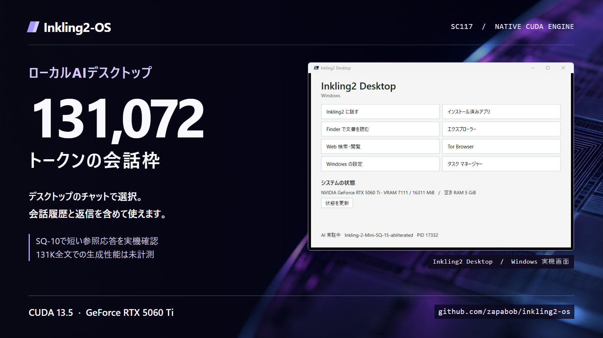

# Inkling2-OS

Inkling2-OS opens a local AI desktop at sign-in. On Windows, use it to talk to Inkling2, open installed apps and settings, read documents and browse the web. On the private Linux appliance, the graphical session and inference service start at boot. Both use the SC117 Inkling-2-Mini models through the [native CUDA engine](https://github.com/zapabob/inkling2-cuda-engine). A local Strata client can share the key-free loopback API.



**Try the 131K window.** In **Inkling2 Desktop → Inkling2 に話す**, set **Context** to **131,072 tokens**. The window includes conversation history, chat-template tokens and room for the reply. Use the matching OS and engine revisions. The [Windows releases](https://github.com/zapabob/inkling2-os/releases) list the published binaries for each revision.

| Status | Capability |
| --- | --- |
| Implemented | Loopback console, optional scoped credentials, read-only document previews, public HTTPS document browsing, RustXNG search and measured-GPU admission. |
| Prior Windows release | The console, key-free browser, Finder, scoped API and Strata 0.8.6 provider registration were exercised. SQ-10, SQ-15 and SQ-20 returned the expected digit and stopped on the short arithmetic fixture. |
| Experimental | The OpenAI-compatible event stream emits the answer once native generation finishes. |
| 131K test coverage | CUDA boundary and ring-wrap tests passed. A Windows SQ-10 worker configured for 131,072 tokens returned the reference answer on short prompts. Full-length document quality and throughput require a separate end-to-end evaluation. Each Windows release requires the three-model checks below. |
| Pending qualification | Physical Linux CUDA inference and matched hardware benchmarks. |
| Private Linux USB | UEFI installation with the Linux CUDA engine, NVIDIA modules, a local graphical console and an offline model volume. See the validation record for the checks run on this image. |

## Windows console

### Resident desktop on Windows

**Context → Auto** sizes the resident worker for the tokenized conversation. Native chat requests can also specify `"context_length": 131072`. Each successful reply and its user message stay in this tab until you start a new conversation or switch models. The output setting reserves up to 128 tokens inside the selected window.

The HTTP model list advertises the native context limit. `GET /v1/engine/status` reports the current resident capacity and worker PID. Increasing capacity can reload the model. The bridge checks measured GPU headroom before loading. Long prompts are processed locally and can take substantially longer than short chats.

Extract the Windows console archive into an empty directory, then extract the matching
engine archive into its `bin` directory. With PowerShell 7.4 or newer, run the desktop
launcher from the extracted directory. Replace the example model directory with your
own SC117 weights and matching tokenizer.

```powershell
./scripts/start-windows-desktop.ps1 -ModelsDir 'C:/Models/SC117' -RegisterAtLogon
./scripts/start-windows-desktop.ps1 -ModelsDir 'C:/Models/SC117'
```

The current user's Start menu and Startup folder receive an **Inkling2 Desktop** shortcut.
The desktop opens applications, documents, Web search, Tor Browser, Windows Settings and
Task Manager. Install the signed Windows x86-64 package from the [Tor Project](https://www.torproject.org/download/)
in `%LOCALAPPDATA%/Programs/Tor Browser` to enable its native launcher. Choose Connect
in Tor Browser on first use. The HTTPS reader rejects onion addresses before DNS resolution.
The Tor package is distributed separately.
The loopback bridge stays available after the window closes. On port 18083, Strata can use
`http://127.0.0.1:18083/v1` without a key. To disable automatic launch, remove the
**Inkling2 Desktop** shortcut from `shell:startup`.

The default preload model is `Inkling-2-Mini-SQ-15-abliterated`. Select another ID with
`-PreloadModel`. The worker retains one model, resets each conversation's sequence state
and releases the previous model when switching. `GET /v1/engine/status` reports the live
worker state. `POST /v1/engine/unload` with an empty JSON object frees an idle worker.
The desktop's initial expert cache caps are 2 GiB VRAM and 512 MiB pinned RAM.
Add `-SkipUsbCache` when the removable drive is in use by the Linux installer.

Build with `cargo build --release --locked --workspace -j 1`. From a Windows bundle, the launcher selects the packaged executable automatically. In PowerShell 7.4 or later, run:

```powershell
./scripts/start-windows-console.ps1 -EnginePath 'C:/Models/bin/inkling2-engine.exe' -ModelsDir 'H:/Models/SC117-SQ-10' -PreviewDir ./docs -Open
```

The default address is `http://127.0.0.1:18081/`. The launcher defaults to key-free local mode. Use `-UseTokens` on shared Windows machines or when forwarding the port. In that mode, `-CopyToken Console` copies the console credential for **Unlock**.

In Strata, add a custom OpenAI Chat Completions connection with base URL `http://127.0.0.1:18081/v1` and use the exact model ID returned by `GET /v1/models`. Local mode does not require an API key. When the launcher uses `-UseTokens`, configure the **Inference** token. Keep each model’s matching `tokenizer.json` beside it.

Use the CUDA executable that supports `generate-token-ids`. The shell reads the matching model chat template and tokenizer, and the engine accepts the resulting token IDs. Select no reasoning for the native adapter.

### SQ-15 and SQ-20 on Windows

The launcher also scans the installed Strata folder under `%LOCALAPPDATA%/Strata/model-weights/SC117/Inkling-2-Mini`. You can add other model folders with `-AdditionalModelsDirs`. All three SC117 weights use the same root `tokenizer.json` from the model publisher. On this workstation the launcher detects the NVMe, SATA SSD and removable USB by their Windows storage bus. The engine keeps priority experts in VRAM and CPU RAM, then caches cold experts in temporary files of up to 256 MiB per drive. It leaves 2 GiB free per volume and uses the original weights when a cache is unavailable. The installed Start menu entry opens the local GUI.

### Publishing a Windows pair

In the x64 Visual Studio Developer PowerShell, set `$engine` to the CUDA engine checkout,
`$sq10`, `$sq15` and `$sq20` to the original model files, and `$qualification` to a new
output directory. Each model needs its matching sibling `tokenizer.json`.

```powershell
./scripts/qualify-native-pair.ps1 -WindowsOnly -EngineRepo $engine -Model $sq10 -AdditionalModel @($sq15, $sq20) -CudaRoot $env:CUDA_PATH -OutputDir $qualification
```

Push each tested source change to its repository's `main`. The engine push builds the CUDA runtime, checks the token protocol and stages the source.
The OS push runs both Rust workspace jobs and the boot tests. Start the OS packaging
workflow on the same main revision and check the resulting run:

```powershell
gh workflow run release.yml --repo zapabob/inkling2-os --ref main
gh run list --repo zapabob/inkling2-os --branch main --commit (git rev-parse HEAD)
gh run list --repo zapabob/inkling2-cuda-engine --branch main --commit (git -C $engine rev-parse HEAD)
```

The three-model hardware run must complete before installing or publishing. Its receipt binds the source, model files, ZIP archives and binaries to SHA-256 digests. Requalify after changing packaged source.

```powershell
$promotion = @{ QualificationDir = $qualification; EngineRepo = $engine; Port = 18083 }
./scripts/promote-native-pair.ps1 @promotion -Stage Install -ModelPath $sq10 -Resident -SkipUsbCache
Invoke-RestMethod http://127.0.0.1:18083/v1/engine/status
./scripts/promote-native-pair.ps1 @promotion -Stage Publish -Tag $newWindowsTag
```

Set `$newWindowsTag` to a new Windows tag with the next available numeric suffix. Installation saves the
previous binaries in the qualification directory. Verify a real chat reply and the desktop
before publication. Publication checks both remote main revisions, all three successful
workflow runs on those revisions, and the installed executable hashes.

### Web search

The image builds RustXNG v0.32.0 from the pinned [GitLab mirror](https://gitlab.com/sahenjp/rustxng-mirror). On Windows, build that pinned revision with `cargo build --locked --release --no-default-features --bin rustxng` and run the resulting executable through the launcher:

```powershell
./scripts/start-rustxng-full.ps1 -Binary 'C:/Tools/rustxng.exe'
./scripts/start-windows-console.ps1 -RustXngPort 29483 -PreviewDir ./docs -Open
```

The launcher validates the upstream `full` profile before starting it. Pass `-Config` for a local RustXNG TOML or YAML override. The appliance reads an optional root-managed `/etc/inkling2/rustxng.toml` and otherwise uses the bundled profile. Enabled web providers receive the search query. Providers that require credentials are available only when explicitly configured. Database engine extensions are omitted from the appliance build.

## Linux diagnostic ISO

Run `./os-image/build-iso.ps1` on an amd64 build host. The live ISO boots directly on the target machine without Docker. It uses memory-backed state and provides a terminal with the diagnostic console service. NVIDIA binaries and SC117 weights are supplied separately for private installations.

## Private Linux USB

The appliance signs in the local console account on tty1 once the bridge is ready. The desktop launcher opens Inkling2 Chat, Finder, Browser, Terminal and System Information. The browser opens `http://127.0.0.1:8080/` without an API key. Browser opens mediated public HTTPS documents and uses RustXNG Full for search. Finder previews approved files under `/var/lib/inkling2/files` through the broker. The graphical session runs as the local console user and can reach the loopback bridge. The AI bridge stays available when the browser window closes.

The **Tor Browser** launcher opens the native [Tor Project release](https://blog.torproject.org/new-release-tor-browser-1603/) in its own Linux account and uses the upstream default profile. The build verifies the Linux archive against the pinned [Tor Browser Developers key](https://support.torproject.org/tor-browser/getting-started/verifying-tor-browser/). Tor Browser operates independently of Inkling2 Browser and Finder.

On the build host, `os-image/Dockerfile.cuda-builder` builds the Linux engine for CUDA 13.5 `sm_120a` and the NVIDIA modules for the appliance kernel. The `private-disk-tools` target stages the driver and graphical session. The disk bundle uses the target's exact byte capacity and contains a UEFI system partition, a persistent ext4 root and a 48 GiB model partition. The Windows writer requests the matching disk identity and verified bundle hashes before replacing the partition table, and reads back its written regions.

The writer streams the original SQ-10, SQ-15, SQ-20 and their shared `tokenizer.json` directly from other physical drives, then verifies all four files on the USB. The appliance mounts the model partition read-only with the Linux NTFS3 driver and grants read access to the inference account. `-CheckOnly` performs the source checks without administrator access. Use the machine's UEFI boot menu to launch the installed USB.

The private appliance enables resident inference. When the GPU and bundled SQ-10 are present, the bridge starts loading SQ-10 in the background while the desktop opens. Selecting another model switches the resident model.

Both Linux images include Wine for 64-bit Windows command-line programs. At the physical console use Ctrl+Alt+F2 to open the unprivileged Inkling2 terminal. Stage approved executables in `/var/lib/inkling2/wine-apps`, then run `wine-inkling2 run PROGRAM.exe` from the terminal. Wine uses a separate display, an isolated network namespace and its own prefix. The installed disk persists the prefix and service state in `/var/lib/inkling2`.

## Paired qualification and release

Run `scripts/qualify-native-pair.ps1` from the x64 Visual Studio Developer PowerShell with the engine checkout, original SQ-10 model, CUDA 13.5 toolkit and an ignored output directory. The gate runs the Rust workspace and tokenizer suites, the CUDA tests and real SQ-10 reference check, then the BIOS, UEFI and installed-disk boot tests. It writes a qualification receipt only after a successful run. The receipt binds both source trees and the packaged assets to checksums.

Publish from the qualified main revisions after their CI and staging workflows pass. `scripts/promote-native-pair.ps1 -Stage Install` checks the qualified source and the archive hashes, replaces the local Windows console binaries, and keeps rollback copies. For the dedicated USB, `scripts/prepare-private-usb.ps1` builds and boots the private disk bundle in QEMU. Pass its verification hashes and original model path to `scripts/write-installed-usb.ps1`. `scripts/promote-native-pair.ps1 -Stage Publish` checks the installed Windows binaries and the verified USB write log before publishing the paired releases. The public ISO supports diagnostics. The private USB carries its own CUDA and model assets.

Read the [architecture](docs/ARCHITECTURE.md), [boot process](docs/BOOT_PROCESS.md), [security model](docs/SECURITY.md), [hardware support](docs/HARDWARE_COMPATIBILITY.md), [limitations](docs/KNOWN_LIMITATIONS.md) and [validation record](docs/V0.1.1_VALIDATION.md).

## Licence

Distributed under the MIT Licence. The [standalone Inkling2 CUDA Engine](https://github.com/zapabob/inkling2-cuda-engine) is a separate project.
